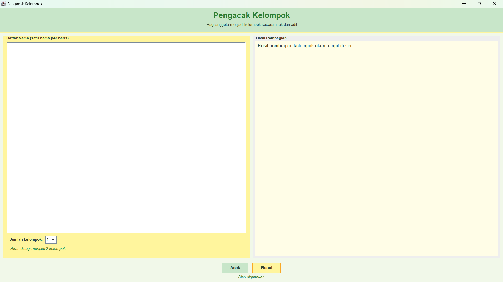
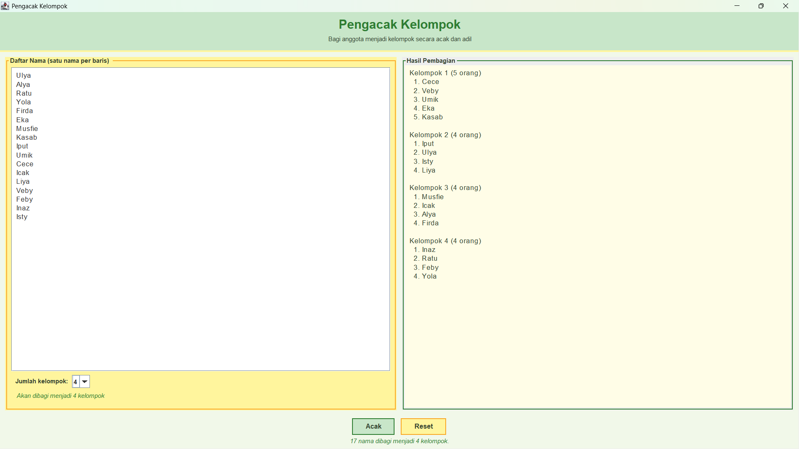
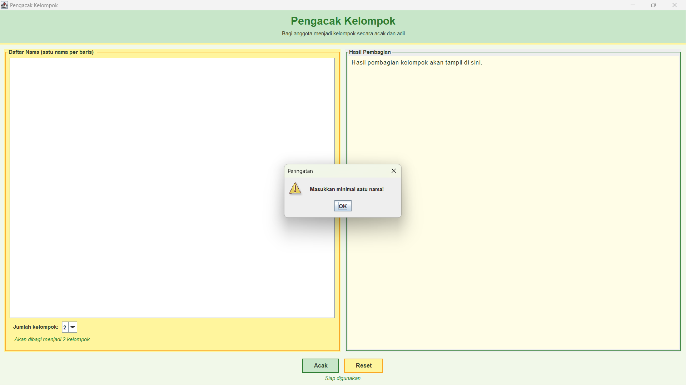
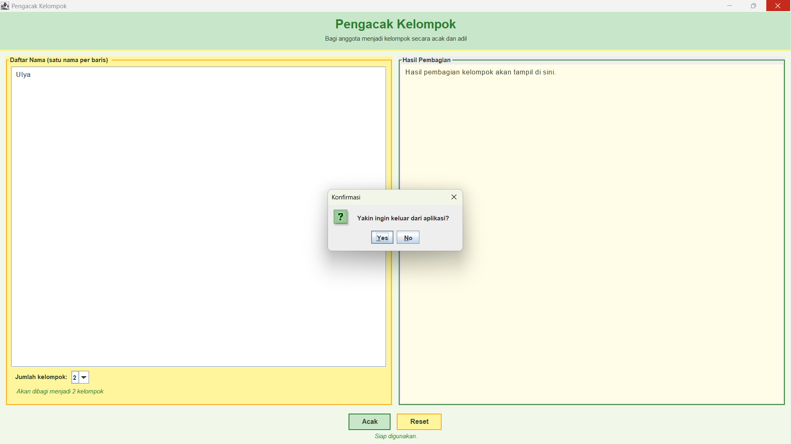

# Pengacak Kelompok (KelompokApp)

**Nama:** Sri Zul'aini Ulya
**NIM:** F1D02410096
**Mata Kuliah:** Latihan Materi GUI - 5C  

---

## 1. Deskripsi Aplikasi

Pengacak Kelompok adalah aplikasi desktop berbasis Java Swing untuk membagi sejumlah anggota menjadi beberapa kelompok secara acak dan merata. Pengguna mengetik daftar nama (satu nama per baris), memilih jumlah kelompok, lalu menekan tombol Acak. Hasil pembagian langsung ditampilkan pada panel di sebelah kanan.

## 2. Fitur Aplikasi

- Memasukkan daftar nama, satu nama per baris.
- Memilih jumlah kelompok (2 sampai 6).
- Mengacak nama dan membaginya secara merata ke setiap kelompok.
- Mengabaikan baris kosong dan spasi berlebih pada daftar nama.
- Menampilkan jumlah anggota pada setiap kelompok.
- Menampilkan peringatan jika daftar nama kosong atau jumlah nama kurang dari jumlah kelompok.
- Menyediakan tombol Reset untuk mengembalikan aplikasi ke kondisi awal.
- Menampilkan konfirmasi sebelum aplikasi ditutup.

## 3. Teknologi

- Bahasa pemrograman: Java
- Library GUI: Java Swing (`javax.swing`) dan AWT (`java.awt`)
- JDK: Java Development Kit 8 atau lebih baru

## 4. Komponen GUI

### Top-Level Container

- `JFrame`: class `KelompokApp` meng-*extend* `JFrame` sehingga menjadi jendela utama yang menampung seluruh komponen lain.

### Intermediate Components

- `JPanel`: mengelompokkan komponen berdasarkan bagian tampilan, yaitu `panelAtas` (judul), `panelTengah` (gabungan panel input dan hasil), panel input (kotak nama dan pilihan jumlah), panel hasil, `panelBawah`, dan `panelTombol`.
- `JScrollPane`: membungkus kotak nama dan kotak hasil sehingga teks dapat digulir jika panjang.

### Atomic Components

- `JLabel`: menampilkan judul, keterangan jumlah kelompok, dan status.
- `JTextArea`: `txtNama` untuk mengetik daftar nama dan `txtHasil` untuk menampilkan hasil (hanya baca).
- `JComboBox`: memilih jumlah kelompok.
- `JButton`: menjalankan aksi Acak dan Reset.
- `JOptionPane`: menampilkan dialog peringatan dan konfirmasi.

### Metode yang digunakan:

- `setBackground()` dan `setForeground()`: mengatur warna latar dan teks komponen.
- `BorderFactory.createLineBorder()`, `createMatteBorder()`, dan `TitledBorder.setTitleColor()`: mewarnai garis tepi, garis bawah header, dan judul panel.
- `UIManager.setLookAndFeel()` dengan `getCrossPlatformLookAndFeelClassName()`: menggunakan Look and Feel lintas-platform agar warna tampil sama di Windows, macOS, dan Linux.

## 5. Layout Manager

### BorderLayout

Digunakan pada `JFrame` utama dan panel-panel yang membutuhkan pembagian area. Jendela dibagi menjadi NORTH (judul), CENTER (input dan hasil), dan SOUTH (tombol dan status). Area CENTER otomatis melebar mengikuti ukuran jendela.

### GridLayout

Digunakan pada `panelTengah` dengan susunan 1 baris dan 2 kolom, sehingga panel input dan panel hasil memiliki lebar yang sama. Juga digunakan pada `panelAtas` (2 baris untuk judul dan subjudul).

### FlowLayout

Digunakan pada `panelTombol` untuk menyusun tombol Acak dan Reset secara berurutan dan rata tengah, serta pada panel pilihan jumlah kelompok untuk menyusun label dan combo box dalam satu baris.

## 6. Event Handling

Aplikasi menggunakan tiga interface event listener.

### ActionListener

Didaftarkan pada `btnAcak` dan `btnReset`. Method `actionPerformed(ActionEvent e)` membedakan sumber event dengan `e.getSource()`, lalu memanggil method `acak()` atau `reset()`.

### ItemListener

Didaftarkan pada `cbJumlah`. Method `itemStateChanged(ItemEvent e)` memperbarui label info (misalnya "Akan dibagi menjadi 3 kelompok") setiap kali pilihan jumlah kelompok berubah. Pengecekan `getStateChange() == ItemEvent.SELECTED` mencegah event diproses dua kali, karena `JComboBox` memicu event saat pilihan lama dilepas dan saat pilihan baru dipilih.

### WindowListener (melalui WindowAdapter)

Didaftarkan pada `JFrame` menggunakan *anonymous inner class*. Method `windowClosing(WindowEvent e)` menampilkan dialog konfirmasi sebelum aplikasi ditutup. `WindowAdapter` dipakai agar tidak perlu meng-*override* seluruh method `WindowListener`.

Class `KelompokApp` mengimplementasikan `ActionListener` dan `ItemListener` secara langsung.

## 7. Alur Algoritma

1. Teks pada `txtNama` dipecah per baris dengan `split("\n")`, lalu setiap baris dirapikan dengan `trim()` dan baris kosong dibuang.
2. Daftar divalidasi: tidak boleh kosong, dan jumlah nama harus minimal sama dengan jumlah kelompok.
3. Daftar diacak dengan `Collections.shuffle()`.
4. Nama dibagikan satu per satu secara bergiliran ke setiap kelompok menggunakan operator modulus (`i % jumlah`), sehingga selisih jumlah anggota antar kelompok paling banyak satu orang.
5. Hasil disusun dengan `StringBuilder` dan ditampilkan pada `txtHasil`.

## 8. Cara Menjalankan

Pastikan JDK telah terpasang dan terminal berada di folder utama proyek.

Kompilasi:

```bash
javac -d out src/KelompokApp.java
```

Jalankan:

```bash
java -cp out KelompokApp
```

## 9. Struktur Proyek

```text
KelompokApp/
├── src/
│   └── KelompokApp.java
├── screenshots/
│   ├── 1-tampilan-awal.png
│   ├── 2-hasil-pembagian.png
│   ├── 3-validasi-nama-kosong.png
│   ├── 4-validasi-nama-kurang.png
│   └── 5-konfirmasi-keluar.png
├── README.md
└── .gitignore
```

## 10. Penyimpanan Data

Aplikasi tidak menyimpan data. Seluruh isian dan hasil pembagian hanya berada di memori selama aplikasi berjalan.

## 11. Dokumentasi Screenshot

### Tampilan Awal



### Hasil Pembagian



### Validasi Nama Kosong



### Validasi Jumlah Nama Kurang


### Konfirmasi Keluar

